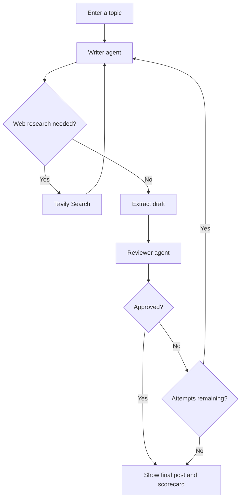

# LinkedIn Post Generator

An AI-powered LinkedIn content studio that turns a topic or professional insight into a polished, review-ready post. It uses a **LangGraph multi-agent workflow** to draft content, search the web when current information is needed, and evaluate the result before presenting it.

## Features

- **Topic-to-post generation:** Start with a topic, project, lesson, or professional experience.
- **AI writing agent:** Generates a professional LinkedIn post with a strong opening, one central takeaway, readable paragraphs, and a relevant closing question or call to action.
- **On-demand web research:** Uses Tavily Search when the writer needs current facts or supporting information.
- **Automated review:** A separate reviewer evaluates each draft against seven writing criteria and returns a structured scorecard with feedback.
- **Iterative refinement:** Rejected drafts are sent back to the writer for revision, up to three attempts.
- **Live workflow visibility:** Follow the graph, execution log, draft, and reviewer feedback in the Streamlit workspace.
- **Copy and export:** Copy the generated post or download it as a `.txt` or `.md` file.
- **Session history:** Review completed posts and revisions during the current Streamlit session.

## Tech Stack

| Component | Technology |
| --- | --- |
| User interface | Streamlit |
| Agent orchestration | LangGraph |
| LLM integration | LangChain |
| Writing model | Cloudflare Workers AI — `@cf/mistralai/mistral-small-3.1-24b-instruct` |
| Review model | Groq — `openai/gpt-oss-20b` |
| Web research | Tavily Search |
| Configuration | python-dotenv |

## How It Works

The application runs a graph with a writer, optional search tool, draft extraction step, and reviewer.



### Review criteria

The reviewer checks each draft for:

1. A strong hook in the first line.
2. One clear and useful takeaway.
3. Short, easy-to-scan paragraphs.
4. A target length of approximately 150–200 words.
5. An engaging closing question or call to action.
6. A natural, professional tone.
7. No hashtags.

The workflow stops when a draft is approved or the three-attempt limit is reached. A post can still be displayed when it has not been approved; the UI makes that status visible.

## Project Structure

```text
LinkedIn_post_generator/
├── linkedin_workflow.py   # LangGraph workflow, writer, search and reviewer agents
├── streamlit_app.py       # Main Streamlit user interface
├── app.py                 # Additional Streamlit app implementation
├── requirements.txt       # Python dependencies
├── .gitignore
└── .env                   # Local API credentials (create this file)
```

Run `streamlit_app.py` to start the main interface.

## Getting Started

### 1. Clone the repository

```bash
git clone https://github.com/srini526/LinkedIn_post_generator.git
cd LinkedIn_post_generator
```

### 2. Create and activate a virtual environment

**Windows PowerShell**

```powershell
python -m venv .venv
.\.venv\Scripts\Activate.ps1
```

**macOS / Linux**

```bash
python3 -m venv .venv
source .venv/bin/activate
```

### 3. Install dependencies

```bash
python -m pip install --upgrade pip
pip install -r requirements.txt
```

### 4. Configure API credentials

Create a `.env` file in the project root:

```env
CF_ACCOUNT_ID=your_cloudflare_account_id
CF_AI_API_TOKEN=your_cloudflare_workers_ai_token
GROQ_API_KEY=your_groq_api_key
TAVILY_API_KEY=your_tavily_api_key
```

You will need:
- A Cloudflare account ID and API token with access to Workers AI.
- A Groq API key for the reviewer model.
- A Tavily API key for web research.

Keep your credentials private. The `.env` file is excluded from Git by `.gitignore`; never commit real API keys.

### 5. Run the application

```bash
streamlit run streamlit_app.py
```

Streamlit will print a local URL in the terminal. Open that URL in your browser.

## Configuration Notes

- The topic input accepts up to **2,000 characters**.
- The writer uses Cloudflare Workers AI; the reviewer uses Groq.
- Tavily Search is invoked only when the writer requests current information.
- The LangGraph workflow allows up to **three draft attempts**.
- Completed-post history is kept in Streamlit session state only. It is not stored in a database and is not a permanent archive.
- This project generates and exports post text; it does **not** publish directly to LinkedIn.

## Troubleshooting

| Issue | What to check |
| --- | --- |
| Missing environment variable | Confirm all four keys are present in the root `.env` file and restart Streamlit. |
| Cloudflare authentication or model error | Verify the account ID, Workers AI token permissions, and model availability. |
| Groq authentication or model error | Check that the Groq API key is valid and the reviewer model is available to your account. |
| Tavily search error | Verify the Tavily API key and available search quota. |
| Generation fails during a workflow step | Review the terminal/server logs for the underlying exception, then retry from the application. |

## Contributing

Contributions and suggestions are welcome. For significant changes, open an issue first to discuss the proposed improvement.

---

Built to explore practical multi-agent orchestration, tool use, and automated quality review for professional content creation.
